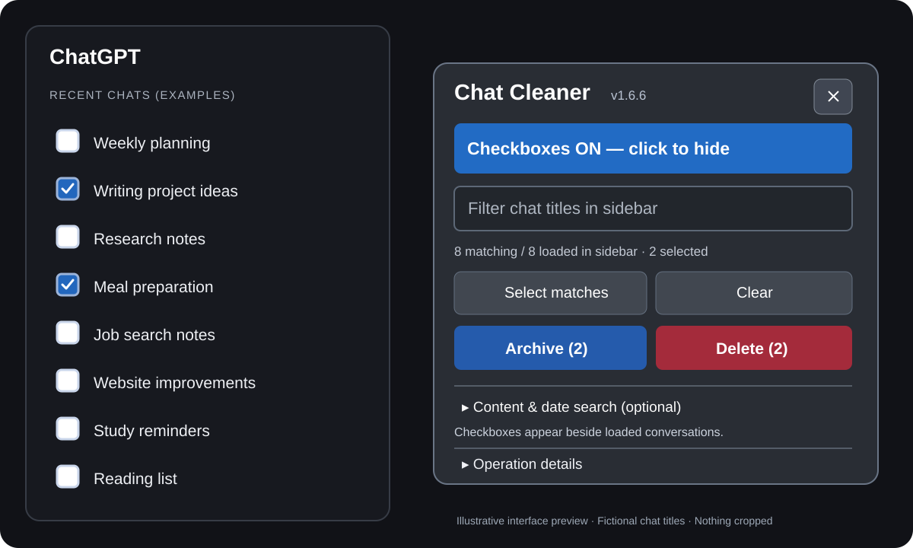

# Chat Cleaner Free Beta — Bulk Delete & Archive ChatGPT Chats

**Select multiple ChatGPT conversations with checkboxes. Archive or delete them in a batch instead of opening every chat's menu yourself.**

Free Chrome extension · No subscription · No extra ChatGPT login · [Privacy details](PRIVACY.md)

### [Download Chat Cleaner Free Beta v1.6.1](https://github.com/ops-by-amber/chat-cleaner-free-beta/raw/refs/heads/main/downloads/chat-cleaner-free-beta-v1.6.1.zip)

[How to install](INSTALL.md) · [Report a bug or request a feature](https://github.com/ops-by-amber/chat-cleaner-free-beta/issues/new) · [Developer profile](https://github.com/ops-by-amber)

> **Beta warning:** Unpacked extension for desktop Chrome (not yet in the Chrome Web Store). Test it on one disposable chat first. Deletion is irreversible.

> **Version note:** The current public download is **v1.6.1**. The preview below depicts the improved **v1.6.6 test build**, which is awaiting upload to public downloads. Do not assume the public ZIP already contains those changes.

## Interface preview

  

*Illustrative demonstration using fictional conversation titles. The whole sidebar and panel are visible; no personal data is shown.*

## What it does

- **Sidebar checkboxes:** select individual conversations, including supported custom-GPT chat links.
- **Batch archive or delete:** acts through ChatGPT's existing menus with a confirmation step.
- **Search by title:** filter conversations currently loaded in the sidebar.
- **Optional content and date search:** import your own `conversations.json` export locally; no message content is sent to the developer.
- **Safety controls:** stop on uncertain menus, keep remaining selections, and show operation details.
- **Optional beta feedback:** after a batch, choose Worked, Had an issue, or Suggestion, with a short comment. Feedback only sends if you click a response.

## Install in Chrome

1. Download the ZIP above and extract it.
2. Open `chrome://extensions` in Chrome and turn on **Developer mode**.
3. Click **Load unpacked**, then select the extracted folder containing `manifest.json`.
4. Refresh `https://chatgpt.com`. Click **Chat Cleaner** at the bottom right.
5. Enable checkboxes, select chats, and choose Archive or Delete.

For screenshots and troubleshooting, see [INSTALL.md](INSTALL.md). Download the named ZIP, **not** GitHub's autogenerated “Source code (zip)” archive.

## Important limitations

- Only conversations currently **loaded in the ChatGPT sidebar** can be selected. Scroll the left sidebar for older entries.
- Folder headings, project headings and GPT landing pages aren't chat conversations and aren't selectable.
- ChatGPT's interface can change. Operations may stop when a menu is unrecognized.
- A conversation disappearing from the sidebar is **not independent proof of permanent server-side deletion**.
- Unpacked GitHub installs **don't auto-update**; check this page for new versions.

## Feedback and support

Found a bug? Use [GitHub Issues](https://github.com/ops-by-amber/chat-cleaner-free-beta/issues/new) (GitHub sign-in required), or email **ops.by.amber@gmail.com**. Please omit private conversation details from your report.

The optional in-extension feedback uses FormSubmit to forward responses to the developer's email. **Delivery activation and live verification are still pending**, so email is the more reliable fallback for now. Read the [privacy information](PRIVACY.md) before submitting feedback.

**Independent community project — not affiliated with, endorsed by, or supported by OpenAI.**

Development and automated tests are maintained separately in a private repository. This public repository is for free-beta downloads, instructions and support. The downloaded extension's JavaScript and CSS are necessarily included in the installable ZIP.
